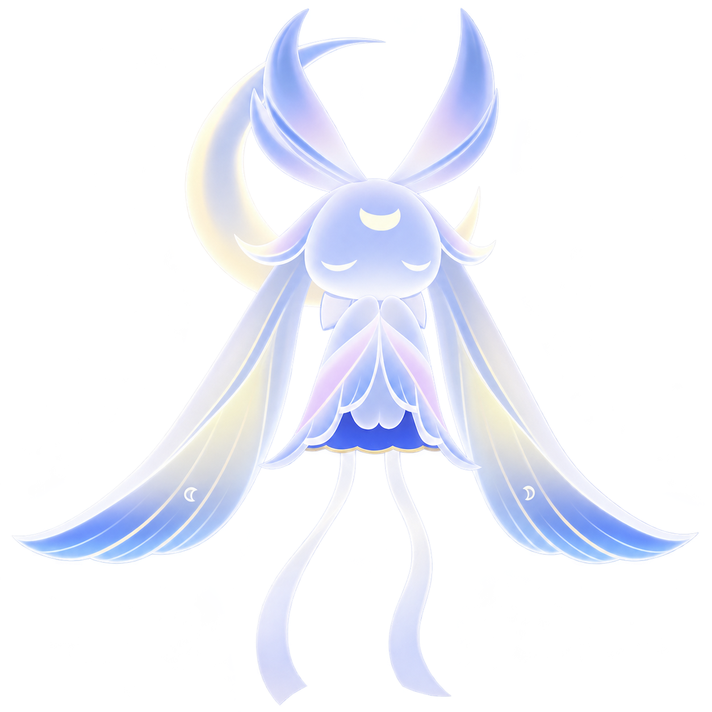

# Nuonota Pet

A standalone Windows desktop pet: a small moon spirit that hovers on your desktop, turns to look at
you, leans into a drag, and settles back when you let go. It runs on its own — no Codex, no account,
no network, no API key, and no separate .NET install.



## Two ways to draw the same character

**Original atlas.** A 73-cell sprite sheet exported from the Codex pipeline, kept as the classic look.

**3D skeletal version.** The rigged model plus its textures: 47 bones, a separately shaded ivory
crescent, flowing arcs and blinking star points. Hover float, appendage open/close, head sway and the
trailing light ribbons update every frame, and the character can genuinely turn around rather than
flipping a sprite.

## Motion

The interesting part is not the idle loop, it is what happens while you drag the pet around.

Both long side panels and the two rear light ribbons are driven by translation velocity, acceleration
and turn rate, with segmented damping so the tips lag behind the body. Reverse direction and the tips
keep going for a moment; let go and they swing back and settle instead of snapping to rest. The
ribbons are gathered first and then given a shared trailing offset, so gathering never cancels the
motion or reopens them into a wide V.

## Interaction

| Input | Result |
|---|---|
| Left drag | Body turns first, side panels and rear ribbons follow with inertia |
| Click | A small bow of the head and a brief ear spread |
| Wheel | Resize between 140 and 640 px, respecting Windows display scaling |
| Right click → Side glance | Head turns first, body follows, then both ease back |
| Right click → Light spin | A full turn with a wind-up, lift, lean and settle |
| Right click menu | Float, droop-ear rest, free wander, occasional idle, look at the mouse, moon-ring shimmer, pause, appearance, quit |
| Tray icon | Bring the pet back, restore click-through, pause, change appearance, quit |

Position, size and preferences survive upgrades. Target is 60 fps; the right-click menu offers a
30 fps battery-saving mode.

## Build

Requires the .NET 10 SDK.

```powershell
cd src
.\build.ps1          # dotnet publish, single-file, win-x64
```

The published executable lands in `src/bin/Release/net10.0-windows/win-x64/publish/`.

Supporting scripts:

- `src/import_model.py` — converts the COLLADA model into the runtime rig description.
- `src/package.py` — assembles the portable folder around the published exe.

## Layout

```
src/                  WPF application: Program.cs, MoonRig.cs, MoonMesh.cs, MoonAura.cs,
                      AppendageDynamics.cs, project file and build scripts
assets/model/         3D model (COLLADA + FBX), textures and rig.json
assets/moon-spirit/   current 2D idle sheet
assets/hd/            clean expression sheet
docs/                 model and motion notes, version by version
```

## Assets

The 3D model, its textures and the rig come from the public model archive at
<https://models.spriters-resource.com/pc_computer/genshinimpact/asset/512863/> (COLLADA, FBX, textures,
47 bones, no animation clips). They are included here because the app ships with them. The character
and the game assets belong to their original creators.

Animations in this app are re-choreographed from frame-by-frame observation of gameplay recordings;
the archive contains no animation data, so nothing here claims to be a direct port of the game's
motion. Drag response, turn handling and the menu actions are desktop-pet interactions added by this
project.

## Notes

- The moon ring and star points are rebuilt locally with real-time geometry and gradients — an
  approximation, not a reproduction of the game shader.
- No window climbing, collision or dialogue features.
- Reference recordings used while choreographing stay out of the repository.

## License

The C# application and scripts are MIT (see `LICENSE`). The bundled model and textures keep their
original owners' terms, as described above.
